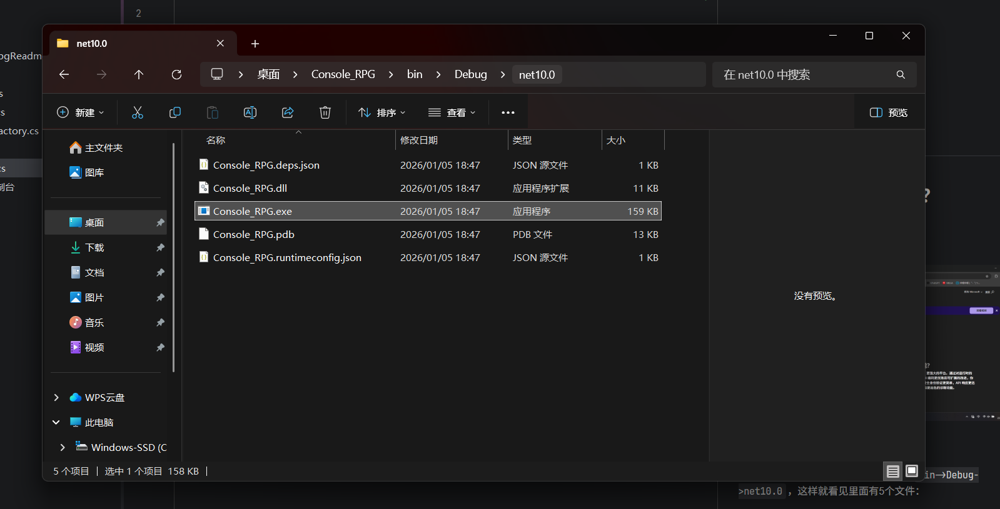

# ConsoleRPG

一个控制台对战游戏

作者：AzLight15

Flash 版本当前为 **v1.1.1**。

***

### 先说未完成的地方

1.没有装备系统
2.没有多存档位（目前只有一个存档）
3.还没有平衡性测试，全部数值都是手动调的

以上抱歉！

***

## 开始游戏之前先干什么？

1.下载这个[.NET](https://dotnet.microsoft.com/zh-cn/download)玩意

例图：

然后安装它

2.找到Console_RPG文件夹里依次点开`bin->Debug->net10.0`，这样就看见里面有这些文件：

打开`Console_RPG.exe`就行了

***

## 第一次玩要注意的事

- 治疗要花**草药**，初始送 3 株。草药只能靠打怪掉（普通怪 35% 掉 1 株，精英怪必掉 2 株），升级也会送 1 株。
- 打坐修炼能拿经验，但**连续打坐收益会递减**，打一场怪才能恢复精神。
- 死了会掉 10% 经验，而且只回一半血，得先休息一下再打。
- 存档写在程序目录下的 `saves` 文件夹里；万一程序目录没有写入权限，会自动改存到系统的用户数据目录。

##### 祝你在这个游戏里玩的开心！
