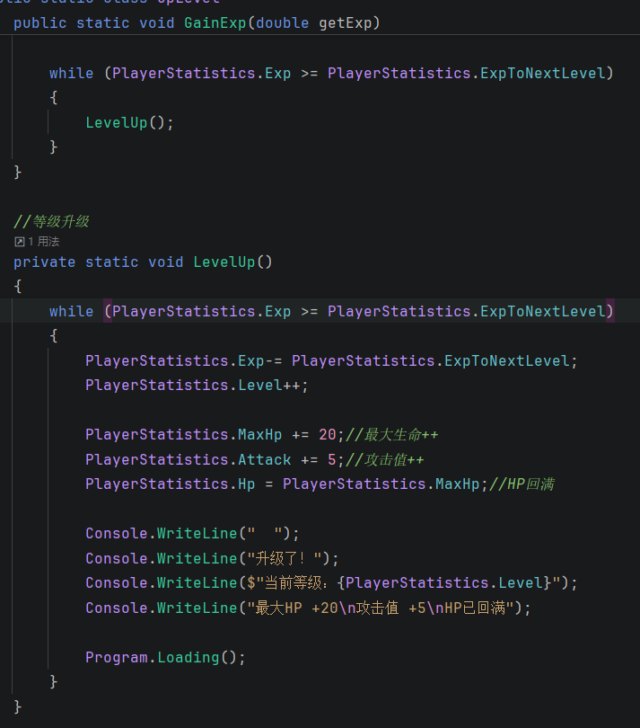

# 开发笔记

***

## 关于Console_RPG

这是我个人开发的一款控制台游戏，可能功能不够全，在此致歉！

如果想玩的话，请在[GitHub](https://github.com/azlight15/console_rpg)页面下载文件

***

## 这个项目有哪些系统？

现在有以下系统：

### 1.`Program.cs`

这是主程序文件，里面有：
主函数——`Program.Main`、
开始菜单——`Program.StartMenu`、
确认菜单——`Program.GameConfirmed`、
选择页面——`Program.OptionsMenu`

架构是这样子：

```csharp
public static class Program
{
    private static bool _running = true;//游戏运行状态
    
    private static void Main()
    {
        StartMenu();
        GameConfirmed();
        while (_running)
        {
            OptionsMenu();
        }
    }
```

***

### 2.`Battle.cs`

这是对战系统

里面有两个方法：对战确认——`StartBattle`和对战系统——`Battle`

流程：

从`Program.OptionsMenu`（选择页面）选择**开始对战**后，会跳到`StartBattle`方法

这时会判断你的Hp值是不是大于等于0，判断通过后从怪物工厂——`MonsterFactory.cs`导入并显示怪物信息，之后转到`Battle`方法进行一换一对战

对战完成后，同时获得经验（Battle部分）并自动升级你的等级，然后回到`StartBattle`方法进行询问是否继续对战

填`y`（大小写都可以）继续，否则回到选择页面

***

### 3.`LevelUp.cs`

这是升级系统，里面有获得经验（LevelUp部分）和升级方法

不知道怎么描述，上个图吧（



~~总感觉像是上了双重保险~~

***

### 4.`Heal.cs`

这个是**治疗功能**，具体工作流程自己去看

***

### 5.`ShowStatus.cs`

这个是**显示玩家当前状态**的，懂得都懂，不赘述

***

### 6.`Player.cs`和`Monster.cs`

这两个是**玩家**和**怪物**的数值面板和基础信息，不多说

***

### 7.`MonsterFactory.cs`

这是“怪物工厂”，是怪物的预设

怪物的数值会跟玩家的等级的增长而增长

该文件搭配`Battle.cs`

***

### 8.`SaveData.cs`

这个是**存档系统**

工作流程：

* 预先建好`Savedata`类
* 把数据存到json文件（存档文件）
* 随时可以存储或读取存档

存档文件一般在`console_rpg-main/bin/Debug/net10.0/saves/save.json`
（旧版本把存档写在 `bin/Debug/net10.0/save.json`，读档时会自动回退兼容）

***

### 9.`ConsoleHelper.cs`

控制台输入输出的统一封装：

* `Clear()`：清屏，在没有真实控制台时兜底，避免 `Console.Clear` 抛异常
* `ReadKeyChar()`：读取单个按键；输入被重定向时改为读取一行文本的首字符
* `WaitAnyKey()`：等待任意键
* `InputEnded`：标记标准输入是否已读到末尾，用于在无法继续读取时主动结束游戏

***

## 最近一次改动

### 修复的问题

* **菜单输入崩溃**：主菜单用 `Convert.ToInt32` 读取输入，输入字母会直接抛异常，现在改用 `int.TryParse` 并给出重选提示
* **无效选项处理错位**：原来无效选项的重新输入逻辑会落到分支外，现在统一在菜单循环内处理
* **精英怪数值错配**：精英怪原本先按旧等级算好血量/攻击，再把等级改成"玩家等级+3"，导致等级与数值对不上。现在先确定最终等级，再按该等级计算属性，最后再整体强化
* **存档路径不可靠**：存档原本写在进程当前工作目录下，从不同位置启动游戏就读不到自己的存档。现在固定写到程序所在目录的 `saves` 子目录，并保留对旧存档的读取兼容
* **读档无容错**：存档文件损坏或被手动改坏时读档会直接崩溃，现在会捕获异常并对非法数值做修正
* **战斗中误触即退出**：战斗中按到非预期按键会直接结束战斗，现在只提示重新选择（怪物照常反击，不会白嫖回合）
* **治疗逻辑重复**：治疗在菜单和战斗中各写了一份，现在统一到 `Heal.HealPlayer()`
* **无控制台时崩溃**：`Console.Clear()` / `Console.ReadKey()` 在输出被重定向时抛异常，现已统一由 `ConsoleHelper` 兜底
* **输入结束死循环**：标准输入读完后再读取会立刻返回，导致菜单与战斗陷入死循环，现在通过 `InputEnded` 主动退出

### 数值平衡调整

| 项目 | 原值 | 现值 | 原因 |
| --- | --- | --- | --- |
| 升级所需经验 | `等级 × 100` | `100 + 等级 × 60` | 原公式增速快于怪物经验增速，后期容易卡级 |
| 升级增加最大HP | +20 | +18 | — |
| 升级增加攻击力 | +5 | +5 | 保持不变 |
| 升级回血 | 直接回满 | 恢复 35% 最大HP | 避免在连续刷怪中靠升级无限续航 |
| 治疗量 | 固定 50 | `20 + 等级 × 6` | 固定值在高等级时相对过强、在低等级时又不够用 |
| 战斗中治疗次数 | 无限制 | 每场最多 3 次 | 避免"无限嗑药"成为无风险最优解 |
| 玩家受击减伤 | `怪物攻击 - 玩家等级` | `怪物攻击 × (1 - 0.05 × 等级)`，最低 35% 减伤 | 原公式在高等级时几乎免疫伤害 |
| 死亡经验惩罚 | 扣除 10% 经验 | 维持 10%，并保证不会扣成负数 | 原公式本身正确，仅补上下限保护 |
| 怪物经验 | `30/50/70 + 等级 × 10/15/20` | `30/50/70 + 等级 × 12/16/20` | 略微上调，匹配新的升级曲线 |

***

## 之后要做什么？

想做其他项目就做其他项目